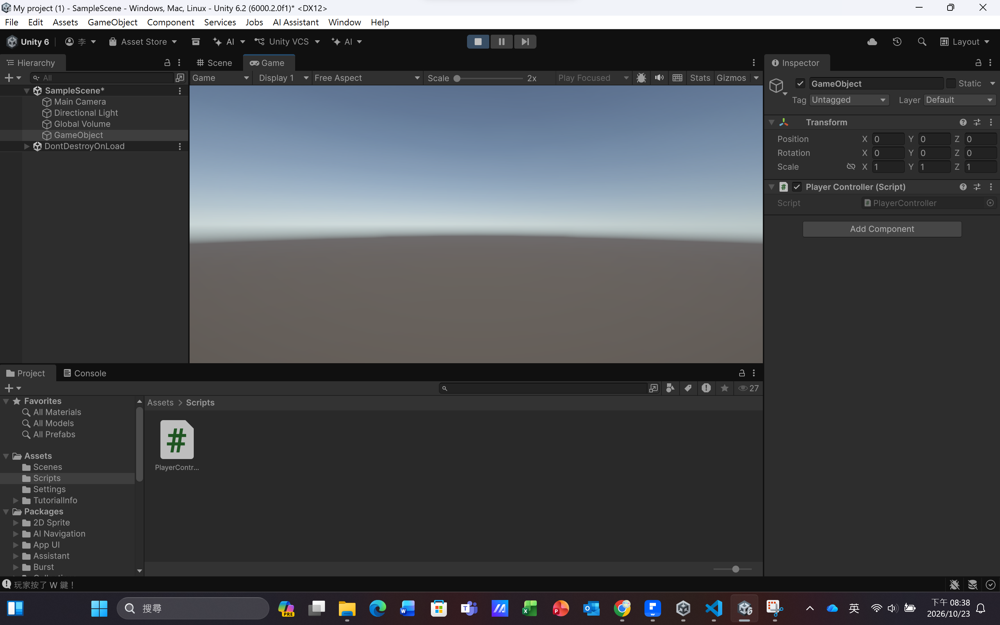

# 第2次練習題目-隨堂-QZ2
>
>學號：113111123
><br />
>姓名：李毓倩
><br />
>作業撰寫時間：240min
><br />
>最後撰寫文件日期：2026/10/23 
>


1. 

### 程式碼（PlayerController.cs）

```csharp
using UnityEngine;
using UnityEngine.InputSystem;

public class PlayerController : MonoBehaviour
{
    void Start()
    {

    }

    void Update()
    {
        // 取得現在鍵盤的狀態
        Keyboard keyboard = Keyboard.current;

        // 偵測玩家有沒有按 W 鍵
        if (keyboard.wKey.isPressed)
        {
            Debug.Log("玩家按了 W 鍵！");
        }
    }
}
```

### 逐行說明

| 程式碼 | 意義 |
|---|---|
| `using UnityEngine;` | 匯入 Unity 基本工具，才能使用 MonoBehaviour、Debug。 |
| `using UnityEngine.InputSystem;` | 匯入 Input System 套件，才能使用 Keyboard 偵測按鍵。 |
| `public class PlayerController : MonoBehaviour` | 建立 PlayerController 類別，繼承 MonoBehaviour，才能掛在物件上。 |
| `void Start()` | 遊戲開始時只執行一次。 |
| `void Update()` | 每一幀都會執行一次，適合持續偵測玩家輸入。 |
| `Keyboard keyboard = Keyboard.current;` | 取得目前使用中的鍵盤，存進變數 keyboard。 |
| `if (keyboard.wKey.isPressed)` | 判斷 W 鍵是否正被按住，是的話執行大括號內的程式。 |
| `Debug.Log("玩家按了 W 鍵！");` | 在 Console 印出「玩家按了 W 鍵！」。 |
| `{ }` | 大括號是範圍，if 成立才執行裡面的內容。 |
| `//` 開頭 | 註解，電腦不執行，只給人看。 |

### 執行結果



---


2. 
Ans:### 程式碼（同一個 PlayerController.cs）

```csharp
using UnityEngine;
using UnityEngine.InputSystem;

public class PlayerController : MonoBehaviour
{
    void Start()
    {

    }

    void Update()
    {
        // 取得現在鍵盤的狀態
        Keyboard keyboard = Keyboard.current;

        // 偵測玩家有沒有按 W 鍵
        if (keyboard.wKey.isPressed)
        {
            Debug.Log("玩家按了 W 鍵！");
        }

        // 偵測玩家有沒有按 A 鍵
        if (keyboard.aKey.isPressed)
        {
            Debug.Log("玩家按了 A 鍵！");
        }

        // 偵測玩家有沒有按 S 鍵
        if (keyboard.sKey.isPressed)
        {
            Debug.Log("玩家按了 S 鍵！");
        }

        // 偵測玩家有沒有按 D 鍵
        if (keyboard.dKey.isPressed)
        {
            Debug.Log("玩家按了 D 鍵！");
        }
    }
}
```

### 逐行說明

前面的 using、class、Start、Update、`Keyboard keyboard = Keyboard.current;` 與第 1 題相同，只需取得一次鍵盤狀態，四個 if 共用。新增的部分如下：

| 程式碼 | 意義 |
|---|---|
| `if (keyboard.aKey.isPressed)` | 判斷 A 鍵是否正被按住。 |
| `Debug.Log("玩家按了 A 鍵！");` | A 鍵被按住時，在 Console 印出訊息。 |
| `if (keyboard.sKey.isPressed)` | 判斷 S 鍵是否正被按住。 |
| `Debug.Log("玩家按了 S 鍵！");` | S 鍵被按住時，在 Console 印出訊息。 |
| `if (keyboard.dKey.isPressed)` | 判斷 D 鍵是否正被按住。 |
| `Debug.Log("玩家按了 D 鍵！");` | D 鍵被按住時，在 Console 印出訊息。 |

四個 if 彼此獨立（不是 else if），所以同時按多個鍵，會同時印出多行訊息。

### 執行結果


## 其他

這堂課的上課步調對我來說偏快，我還不太習慣。老師通常會一次示範完整個流程，我沒辦法一步一步跟著做，等到自己實作時，常常做到一半就忘記前面的步驟。

這次作業我是自己從安裝 Unity、建立專案、新增腳本，一步一步慢慢做完，過程中也遇到檔名打錯、腳本重複掛到物件上等問題，但解決之後，我比較清楚每個步驟的用途。
